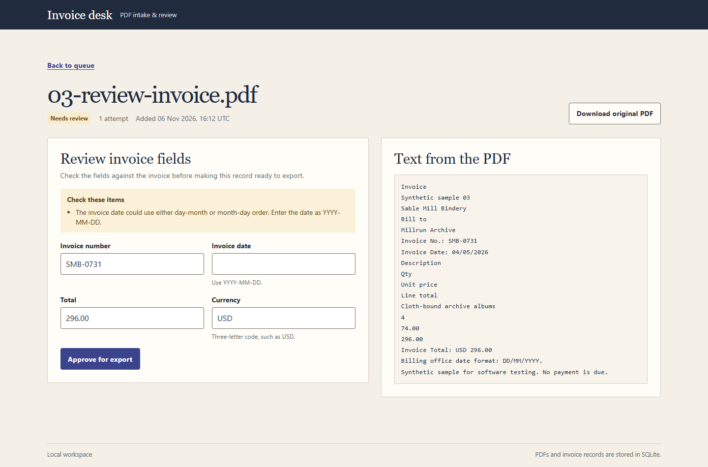

# Invoice desk

Upload a PDF invoice, check the extracted fields, and export the records that are ready. Invoice desk runs locally with FastAPI, SQLite, pypdf, and server-rendered HTML.



## Run on Windows

Open PowerShell in this folder with Python 3.11 or newer installed.

```powershell
py -3 -m venv .venv
.\.venv\Scripts\python.exe -m pip install -r requirements.txt
.\.venv\Scripts\python.exe -m uvicorn app.main:app --host 127.0.0.1 --port 8000
```

Open [Invoice desk](http://127.0.0.1:8000). Stop the server with `Ctrl+C`. On macOS or Linux, use `python3 -m venv .venv` and `.venv/bin/python` in the commands above.

## Walk through the demo

1. Select **Load sample invoices**. Use **Refresh queue** while the worker processes the batch. Two synthetic invoices become ready to export. The third goes to review.
2. Open `03-review-invoice.pdf`. Its source says `04/05/2026`, and its footer specifies `DD/MM/YYYY`. Enter `2026-05-04` and approve it.
3. Return to the queue and download the CSV. It now contains all three invoices, including the corrected date.
4. Choose `samples/01-studio-invoice.pdf` in the upload form. The app opens the existing job because the file bytes match an earlier upload.

## How it works

| Stage | Implementation |
| --- | --- |
| Upload | The server checks the PDF header and size. SQLite stores the original bytes and job together. A unique SHA-256 hash makes repeated uploads return the same job, even under concurrent requests. |
| Processing | A background worker claims one job in a short SQLite transaction. Expired claims can be retried after a restart. A claim token prevents a stale worker from overwriting a newer attempt. |
| Extraction | pypdf reads embedded text. Label matching finds invoice numbers, issue dates, totals, and currency codes. Field validation keeps ambiguous dates and conflicting values in the review queue. |
| Review and export | Correct the fields alongside the extracted text. SQLite guards the approval transition. The CSV includes only ready invoices and keeps amounts as decimal strings. |

The app stores its database under `data/invoices.sqlite3`. Set `INVOICE_DB` before launching to choose a separate database. This is a single-user portfolio demo meant for localhost. Use synthetic or non-sensitive invoices. The parser supports up to 10 MB and 20 pages per file, recognizes common English field labels, and sends image-only PDFs to manual review. Text extraction has no OCR step.

## Run the tests

```powershell
.\.venv\Scripts\python.exe -m pip install -r requirements-dev.txt
.\.venv\Scripts\python.exe -m unittest discover -s tests -v
```

The tests cover sample extraction, upload deduplication, worker claims and recovery, review validation, and CSV export. To regenerate the synthetic PDFs after installing the development dependencies, run `.\.venv\Scripts\python.exe scripts/generate_samples.py` from this folder.

## Project files

- `app/main.py` serves the web interface and handles upload, review, and export.
- `app/worker.py`, `app/extraction.py`, and `app/storage.py` handle processing, parsing, and persistence.
- `app/templates/` and `app/static/` contain the interface.
- `samples/` and `tests/` contain the demo files and test suite.
